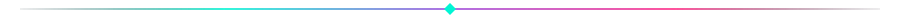
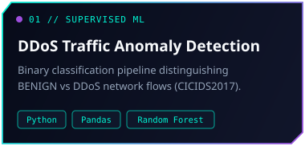
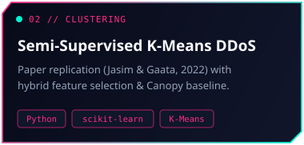
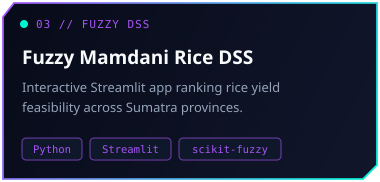

<div align="center">



<br/><br/>

[](https://qolyubmir24.github.io/)
[](https://www.linkedin.com/in/mirwan-qolyubi-58bb9337b)
[](https://instagram.com/qolyub_mir)


<br/><br/>


</div>

### `// ABOUT ME`

> Informatics Engineering student at **UPN "Veteran" Yogyakarta** focusing on **Machine Learning** and **Data Science** with **Python** — turning raw data into predictive models, clustering insights, and decision support systems.

```python
mirwan = {
    "role": "Machine Learning & Data Science Enthusiast",
    "primary_stack": ["Python", "scikit-learn", "Pandas", "NumPy", "Jupyter", "Streamlit"],
    "research_focus": ["Network Anomaly Detection", "Semi-Supervised Clustering", "Fuzzy DSS"],
    "open_to": ["Data Science / ML Internships", "Applied AI Research", "Collaboration"],
}
```

<div align="center">

</div>

### `// TECH STACK`

<div align="center">

**`PRIMARY // ML & DATA SCIENCE`**

<p>
  
</p>


<br/>

**`SUPPORTING // SOFTWARE ENGINEERING & WEB`**

<p>
  
</p>


</div>

### `// FEATURED ML & DATA SCIENCE PROJECTS`

<div align="center">

<table>
  <tr>
    <td width="33%" align="center">
      <a href="https://github.com/qolyubmir24/Data-Science-Practicum-Project_IF-H">
        
      </a>
    </td>
    <td width="33%" align="center">
      <a href="https://github.com/qolyubmir24/ML">
        
      </a>
    </td>
    <td width="33%" align="center">
      <a href="https://github.com/qolyubmir24/fuzzy-logic-scpk">
        
      </a>
    </td>
  </tr>
</table>

</div>

<details>
<summary><strong><code>+ MORE // OTHER SOFTWARE &amp; CS COURSEWORK PROJECTS</code></strong></summary>

| Project | Stack | Summary |
|---|---|---|
| **[2D Vector Graphics Canvas](https://github.com/qolyubmir24/grafika-komputer-sederhana)** | `HTML5 Canvas` `JavaScript` | Browser-based vector drawing tool with move, scale, rotate, shear transforms, and undo/redo. |
| **[Portfolio Website](https://github.com/qolyubmir24/qolyubmir24.github.io)** | `HTML` `CSS` `JavaScript` | Personal portfolio website hosted on GitHub Pages. |
| **[Ellipse Geometry Calculator](https://github.com/qolyubmir24/ellipse-geometry-calculator)** | `Java` `OOP` `Multithreading` | OOP hierarchy and multithreaded calculations for ellipses and derived 3D shapes. |
| **[Berkendar Driving School](https://github.com/qolyubmir24/berkendar-driving-school-system)** | `Java` `OOP` | Console system modeling students, instructors, vehicles, and tiered driving exams. |
| **[CLI Store Inventory & Cashier](https://github.com/qolyubmir24/algorithm-advance-project)** | `C++` `File I/O` | Online/offline store simulation with persistent text-file inventory and transaction records. |

</details>

<div align="center">

</div>

### `// GITHUB ANALYTICS`

<div align="center">


<br/>


</div>
