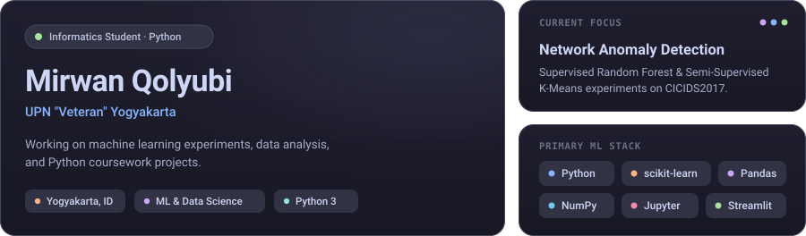
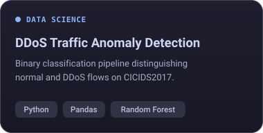
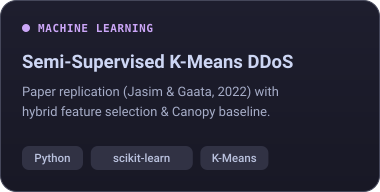
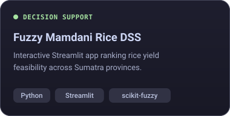

  

---

### Projects

<table>
  <tr>
    <td width="33%" align="center">
      
    </td>
    <td width="33%" align="center">
      
    </td>
    <td width="33%" align="center">
      
    </td>
  </tr>
</table>

Other coursework &amp; web repositories (Web, Java, C++)

| Project | Stack | Notes |
|---|---|---|
| **[2D Vector Graphics Canvas](https://github.com/qolyubmir24/grafika-komputer-sederhana)** | `HTML5 Canvas` `JavaScript` | Browser 2D vector drawing tool with move, scale, rotate, shear, and undo/redo. |
| **[Portfolio Website](https://github.com/qolyubmir24/qolyubmir24.github.io)** | `HTML` `CSS` `JavaScript` | Personal portfolio site hosted on GitHub Pages. |
| **[Ellipse Geometry Calculator](https://github.com/qolyubmir24/ellipse-geometry-calculator)** | `Java` `OOP` `Multithreading` | Java OOP console app for ellipses and derived 3D shapes with multithreaded workers. |
| **[Berkendar Driving School](https://github.com/qolyubmir24/berkendar-driving-school-system)** | `Java` `OOP` | Java OOP console program for students, instructors, vehicles, and exam tiers. |
| **[CLI Store Inventory &amp; Cashier](https://github.com/qolyubmir24/algorithm-advance-project)** | `C++` `File I/O` | C++ console store simulation that saves stock, staff, and orders in text files. |

---

### Toolbox

---

### Activity & Analytics

<picture>
  <source media="(prefers-color-scheme: dark)" srcset="https://raw.githubusercontent.com/qolyubmir24/qolyubmir24/output/github-snake-catppuccin.svg" />
  <source media="(prefers-color-scheme: light)" srcset="https://raw.githubusercontent.com/qolyubmir24/qolyubmir24/output/github-snake-latte.svg" />
  
</picture>

  

 

